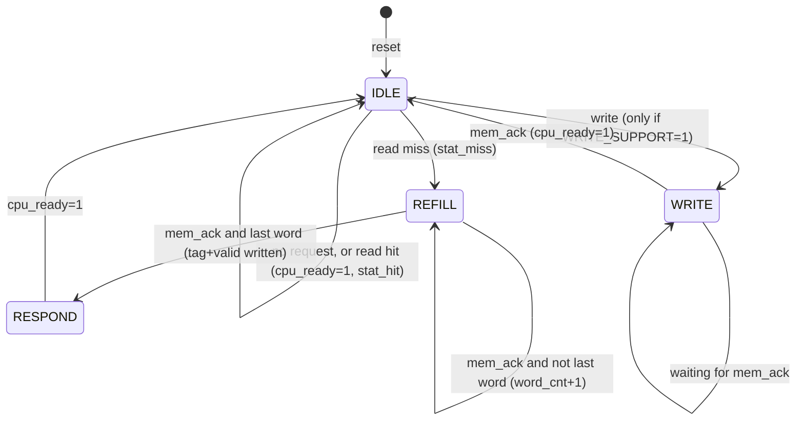

# Controller FSM

Owner: M1. Code: `rtl/cache_controller.v` (FSM) and `rtl/cache_top.v` (wiring).
The timeline numbers below were produced by simulation (`MEM_LATENCY = 4`), not estimated.

## 1. State diagram



## 2. Why each state exists

| State | Why |
|---|---|
| IDLE | Tag compare is combinational, so a hit can be answered in the same cycle. A miss is detected here and counted once (`stat_miss`), then the FSM leaves, so it cannot be counted again. |
| REFILL | Main memory returns one word per `mem_req`/`mem_ack` handshake, so we need a loop of 4 handshakes (`word_cnt` 0..3). |
| RESPOND | Data and tag/valid are written at the clock edge after the last ack. `data_ram` is read asynchronously, so one cycle later the requested word can be read from it. `cpu_ready` is given here, with no stat pulse. |
| WRITE | Only with `WRITE_SUPPORT=1`: write-through to memory and wait for the ack. |

## 3. State table

`hit` = valid and tag match for the current `cpu_addr`. `last` = `word_cnt == WORDS_PER_BLOCK-1`.

| State | Condition | Outputs (all others 0) | Next state |
|---|---|---|---|
| IDLE | `!cpu_valid` | none | IDLE |
| IDLE | `cpu_valid & hit & !is_write` | `stat_hit`, `cpu_ready` | IDLE |
| IDLE | `cpu_valid & !hit & !is_write` | `stat_miss` | REFILL |
| IDLE | `cpu_valid & hit & is_write` (WS=1) | `stat_hit`, `data_we` (cpu data) | WRITE |
| IDLE | `cpu_valid & !hit & is_write` (WS=1) | `stat_miss` (no allocate) | WRITE |
| REFILL | `!mem_ack` | `mem_req`, `data_wsel=word_cnt` | REFILL |
| REFILL | `mem_ack & !last` | `mem_req`, `data_we` (word `word_cnt`) | REFILL, `word_cnt+1` |
| REFILL | `mem_ack & last` | `mem_req`, `data_we`, `tag_we`, `valid_we` | RESPOND |
| RESPOND | always | `cpu_ready` | IDLE |
| WRITE | `!mem_ack` | `mem_req`, `mem_we` | WRITE |
| WRITE | `mem_ack` | `mem_req`, `mem_we`, `cpu_ready` | IDLE |

`is_write = (WRITE_SUPPORT != 0) && cpu_we`. With `WRITE_SUPPORT=0` a request with `cpu_we=1` is handled as a read (lookup/refill as usual, nothing stored), so the CPU never hangs.

Other points:
- `word_cnt` is forced to 0 whenever the state is not REFILL, so every refill starts at word 0.
- Reset (`rst_n=0`, synchronous): state = IDLE, `word_cnt` = 0. `valid_ram` clears all valid bits itself. A reset in the middle of a refill leaves no valid half-filled line.
- Valid bit and tag are set only with the last word. The cache is blocking (one request at a time), so a half-filled line is never looked up.
- Mealy outputs: needed for 1-cycle hits (see header of `cache_controller.v`).

## 4. Miss timeline (MEM_LATENCY = 4, request `0x1A2C`, simulated)

Memory behaviour (plan.md 4.2): `mem_ack` comes `MEM_LATENCY` cycles after `mem_req` is first seen. In the ack cycle the cache stores the word and the next word's request starts in the following cycle.

| Cycle | State | `mem_req` | `mem_ack` | `mem_addr` | Events |
|---|---|---|---|---|---|
| 0 | IDLE | 0 | 0 | | request arrives, tag compare fails: **`stat_miss` pulse** |
| 1 | REFILL | 1 | 0 | `0x1A20` | word 0 requested |
| 2..4 | REFILL | 1 | 0 | `0x1A20` | waiting |
| 5 | REFILL | 1 | **1** | `0x1A20` | word 0 written (`data_we`) |
| 6 | REFILL | 1 | 0 | `0x1A24` | word 1 requested |
| 7..9 | REFILL | 1 | 0 | `0x1A24` | waiting |
| 10 | REFILL | 1 | **1** | `0x1A24` | word 1 written |
| 11..14 | REFILL | 1 | 0 | `0x1A28` | word 2 requested (cycle 11), waiting |
| 15 | REFILL | 1 | **1** | `0x1A28` | word 2 written |
| 16..19 | REFILL | 1 | 0 | `0x1A2C` | word 3 requested, waiting |
| 20 | REFILL | 1 | **1** | `0x1A2C` | word 3 written, **`tag_we` + `valid_we`** |
| 21 | RESPOND | 0 | 0 | | **`cpu_ready`**, `cpu_rdata` = word 3 |
| 22 | IDLE | | | | next request (e.g. `0x1A28`) is a **hit** in this cycle |

## 5. Miss penalty formula

Latency = cycles from `cpu_valid` asserted up to and including the `cpu_ready` cycle (same definition as `latency_cycles` in plan.md 4.5).

```
hit latency       = 1                                      (hit time)
miss latency      = 1 (IDLE detect) + W * (L + 1) + 1 (RESPOND)
                  = W*(L + 1) + 2          W = words per block, L = MEM_LATENCY
miss penalty      = miss latency - hit time
                  = W*(L + 1) + 1
```

Base config `W = 4`, `L = 4`: miss latency = 4*5 + 2 = **22**, miss penalty = **21** cycles. (`L=1` gives 10; `L=10` gives 46.)

Matching the "miss_penalty ~ 4 * (MEM_LATENCY + overhead)" form: overhead is **1 cycle per word**, the ack cycle in which the word is stored before the next request can begin, and there is a **fixed 2-cycle overhead per miss** (the IDLE cycle that detects the miss and the RESPOND cycle that returns the data). For other block sizes use `W = BLOCK_BYTES/4`.

AMAT (for M5): `AMAT = hit_time + miss_rate * miss_penalty = 1 + miss_rate * (W*(L+1)+1)`. Measured AMAT (average `latency_cycles` over all requests) is the same quantity, so the two should agree exactly for the same trace.

## 6. Write support (optional, `WRITE_SUPPORT=1`)

Write-through, no-write-allocate:
- Write hit: the word is updated in the cache (in the IDLE cycle) and written to memory (WRITE state). Stat: hit.
- Write miss: only written to memory, the line is not allocated. Stat: miss.
- `cpu_ready` for a write comes with the memory ack. Write latency = 1 IDLE cycle + (L + 1) WRITE cycles (the last one carries the ack and `cpu_ready`) = `L + 2` cycles (measured: 6 for `L=4`).

Default is off (`WRITE_SUPPORT=0`). In `cache_top` the parameter is `WRITE_SUPPORT`.

## 7. Viva questions to be ready for

1. *Why is the controller Mealy?* Hit must be answered in the same cycle as the compare; Moore would add a cycle to every hit.
2. *Why is there a RESPOND state instead of answering at the last ack?* The data is written at the clock edge; the RAM is read one cycle later. It keeps `cpu_rdata` coming from a single path (`data_ram`).
3. *Why valid bit?* RAM contents are unknown after power-up. Tag 0 would falsely match address 0 without it.
4. *Why set valid with the last word?* So a line is never valid while it holds a mix of old and new words.
5. *Why count `stat_miss` in IDLE?* The FSM leaves IDLE on a miss, so it is counted exactly once per request.
6. *What is the miss penalty?* `W*(L+1)+1` cycles above the hit time (21 for the base config).
